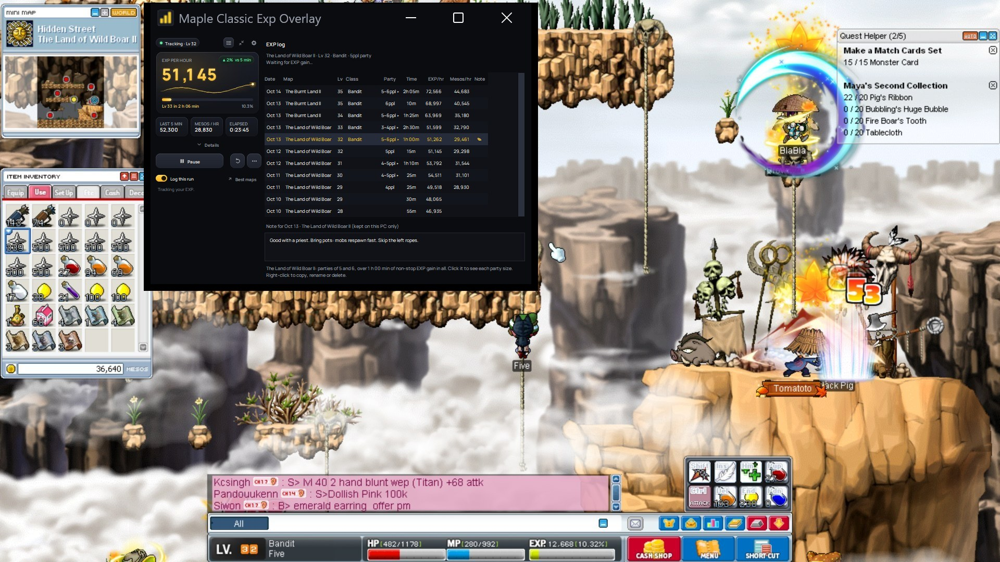
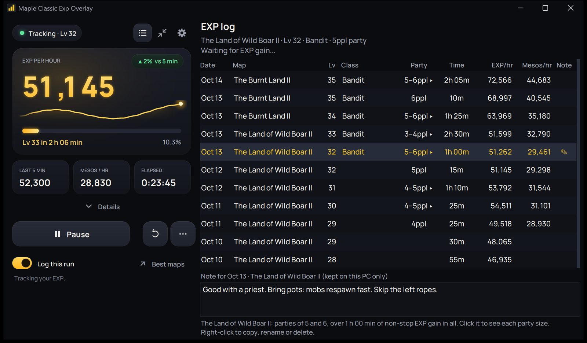

<h1> Maple Classic Exp Overlay（中文版）</h1>

**一款免费的《MapleStory Classic World》经验追踪器。** 一个小窗口贴在游戏旁边，显示你的升级速度、金币收入，以及[适合你职业的最佳地图](https://mcwo.app)。

> 本项目是 [beanguri/Maple-Classic-Exp-Overlay](https://github.com/beanguri/Maple-Classic-Exp-Overlay) 的**中文汉化版**（软件界面与文档均已汉化），原作者为 beanguri，遵循 MIT 协议。游戏本身的地图名、职业名等仍按游戏内的英文识别，因此不会被翻译。

**[在这里下载](../../releases/latest)** · [如何安装](#如何安装)

> **这是测试版。** 它能用，但可能会遇到一些不完善的地方。我在持续改进，请记得回来看看更新。如果有什么不能用，请[告诉我](../../issues)！

## 它显示什么

- **每小时经验**：整个会话的和最近 5 分钟的，以及距离下一级还要多久
- **每小时金币**：从你的背包中读取；还有**每小时净金币**（扣除药水花费）
- **你刷过的每张地图的日志**：在那里的经验/小时和金币/小时、当时的等级和职业、单人还是组队

你不需要输入任何东西，它会自己从游戏画面中读取这一切。

## 如何安装

### 在 Windows 上（10 或 11）

1. 打开**[下载页面](../../releases/latest)**，在 **Assets** 下点击 **Maple-Classic-Exp-Overlay-v…zip** 文件。（不是 “Source code”。）
2. 在“下载”文件夹里**右键点击**该压缩包，选择**全部解压缩…**，然后点击**解压缩**。直接双击是不够的。
3. 打开新生成的文件夹，再打开里面的 **Maple Classic Exp Overlay** 文件夹，双击 **Maple Classic Exp Overlay.exe**（它可能只显示为 **Maple Classic Exp Overlay**，带有金色图表图标）。

**出现“Windows 已保护你的电脑”？** 点击**更多信息**，再点击**仍要运行**。Windows 对任何不是大公司出品的新程序都会这样提示。

**请把整个文件夹放在一起：** 程序需要它旁边的那些文件。要放到桌面上，请右键点击 .exe，选择**发送到 > 桌面快捷方式**（Windows 11 上在**显示更多选项**里）。

### 在 macOS 上

它可以配合游戏自带的 Mac 版使用，也可以配合通过 CrossOver、Whisky、Parallels 或游戏串流运行的 Windows 版使用。**这是测试性质的下载：我没有 Mac，所以没有亲自测试过**（GitHub 的自动测试在真实的 Mac 上运行，但没有运行游戏）。已有玩家确认它能在使用 Nexon Mac 启动器的 Apple Silicon Mac 上工作；Intel 尚未确认。Mac 版来自 thanhphamvan、fabriciorby 和 cpaez33 的工作，他们已经配合游戏试用过。如果你试用了，请告诉我结果。

1. 在[下载页面](../../releases/latest)选择适合你 Mac 的文件（需要 macOS 14 或更新）。苹果菜单 > 关于本机：**Apple M1/M2/M3/M4** = `...-macOS-AppleSilicon.dmg`，**Intel** = `...-macOS-Intel.dmg`。
2. 打开它，把 **Maple Classic Exp Overlay** 拖到“应用程序”里。
3. 先打开一次（macOS 会拒绝，因为它没有用苹果开发者账号签名）。然后进入**系统设置 > 隐私与安全性**，向下滚动到“已阻止 Maple Classic Exp Overlay”，点击**仍要打开**并确认。如果没有出现这个按钮，请在终端里运行一次下面的命令，然后再打开应用：`xattr -dr com.apple.quarantine "/Applications/Maple Classic Exp Overlay.app"`
4. 在**系统设置 > 隐私与安全性 > 屏幕录制**中允许它（它是从屏幕读取游戏的），然后重新启动它。如果 macOS 询问是否允许该应用绕过系统的私人窗口选择器来访问屏幕，请点击**允许**并重新启动。更新后 macOS 可能会再次询问。它通过标题里的 “MapleStory” 找到游戏窗口；如果找不到，请使用**选择区域**。

macOS 上暂时没有快捷键。

## 如何使用

1. **启动 MapleStory**，再启动悬浮窗。它会自己找到游戏窗口。
2. **不要让悬浮窗遮住**小地图、经验条、背包底部的金币或队伍列表。如果挡住了，它会告诉你。
3. **点击开始**并开始游戏。如果 15 秒内没有获得经验，或者你离开了地图，它会自动暂停，并在你下次获得经验时继续。换到新地图会重新开始计数（除非开启了**不重置**）。
4. **想统计金币：** 开始时以及之后偶尔打开背包。**想统计净金币：** 把你的药水放在快捷栏上。

| 控件 | 作用 |
|---|---|
| **开始 / 暂停** | 开始和停止追踪 |
| **重置**（圆形箭头） | 从零重新开始 |
| **记录本次** | 关闭后，这一轮不会写入日志。这一轮结束后会自动重新打开。 |
| **不重置** | 适用于跨地图刷怪：换地图不会重新开始计数。这些记录只保存在你的电脑上。 |
| **最佳地图** | 打开 [mcwo.app](https://mcwo.app)，按你的等级、队伍人数和职业筛选 |
| **…**（更多） | **查看截取**显示它读到了什么；如果找不到经验数字，可用**选择区域** |
| 日志、精简和 ⚙ 图标 | 日志、更小的窗口（方形、宽屏或长条）和设置 |

快捷键（Windows）：**Shift+1** 开始/暂停，**Shift+2** 重置，**Shift+3** 记录本次，**Shift+4** 精简。可在 ⚙ 中更改。

**更多内容：** [完整指南](docs/guide.md)涵盖日志、精简形状、快捷键、所有设置、净金币与药水、最佳地图网站以及准确度如何。

## 出问题了？

**请先点击查看截取**（在 **…** 里）。它会准确显示悬浮窗读到了什么。

| 问题 | 解决办法 |
|---|---|
| 打开 .exe 时出现错误 | 请先解压压缩包（第 2 步）。它不能在压缩包内部运行，也不能离开它所在的文件夹运行。 |
| “未找到 MapleStory 窗口” | 请先启动游戏，如果已最小化请将其还原。 |
| “找不到经验条” | 确保没有任何东西遮住游戏底部，包括悬浮窗。游戏窗口非常小的话，请调大。 |
| 金币显示“请打开背包” | 打开背包，并确保底部的金币没被遮住（在较小的窗口里聊天栏可能会遮住）。 |
| 地图名不对 | 右键点击该日志行，选择**重命名地图**。 |
| 其他任何问题 | ⚙ > **报告错误**：**发送给开发者**（无需账号，你能看到发送的内容）或在 GitHub 上报告。 |

更多解决办法：[完整指南](docs/guide.md#出问题了怎么办)。

## 安全吗？允许使用吗？

- **请只从本仓库的 [Releases](../../releases) 下载。** 其他人复制了这份代码（这是允许的，它是开源的），但他们的副本不是我的，我也没有检查过。我的版本由 GitHub 构建，你可以[验证这一点](docs/download.md)。
- **它只是查看你的屏幕**，就像录屏软件一样。它从不接触游戏的文件或内存，也从不替你按键或点击。
- **你的日志、备注、设置和药水数据都保存在你的电脑上。** 它只会在以下情况联网：检查更新；以及只有在你同意的情况下，向最佳地图网站分享完成的 15 分钟记录，并发送每日运行状况报告（仅含数字）。检查更新、分享和运行状况报告都可以在 ⚙ 中单独关闭。错误报告只有在你发送时才会发出。不会发送任何关于你身份的信息。详情见：[隐私](docs/privacy.md)。
- **你的杀毒软件可能会误报。** 所有代码都公开在这里，任何人都可以检查它做了什么。
- **它与 Nexon 无关，也不是 Nexon 出品。** 与任何第三方工具一样，使用风险自负。

## 更新

有新版本时，悬浮窗会在启动时告诉你。下载新版本并用它替换旧版本：你的日志、备注和设置会保留。更新内容见：[CHANGELOG.md](CHANGELOG.md)。

### 代码签名政策

计划使用 [SignPath Foundation](https://signpath.org) 的免费代码签名，这样 Windows 就不会再对新下载的文件发出警告。只有由本仓库的 Build 工作流构建的版本才会被签名。

- 提交者和审核者：[beanguri](https://github.com/beanguri)
- 批准者：[beanguri](https://github.com/beanguri)
- 隐私政策：见[隐私](docs/privacy.md)。简而言之：你的日志和备注都留在你的电脑上；只有在你开启分享完成的 15 分钟记录或每日运行状况报告时（两者在你同意之前都是关闭的，且可随时在设置中关闭）、在你对错误报告点击**发送给开发者**时，或者检查 GitHub 上是否有新版本时（也可以关闭），悬浮窗才会向其他系统发送任何东西。

## 更多

- [完整指南](docs/guide.md) · [隐私](docs/privacy.md) · [下载来自哪里](docs/download.md) · [开发者文档](docs/developers.md)（从源码运行、构建、测试、复刻）
- 致谢：[经验表](https://meowdb.com/msclassic/guides/exp-table-level-1-to-100)（用于推算你的等级）和[地图名列表](https://meowdb.com/msclassic/maps/all)（`assets/maps.txt`）来自 meowdb，一个玩家自制的 MapleStory Classic 数据库（谢谢）。地图名由 [Tesseract OCR](https://github.com/tesseract-ocr/tesseract)（Apache 2.0 协议）读取，已包含在下载内容中。字体是 [Manrope](https://github.com/googlefonts/manrope)（SIL 开放字体许可，`assets/fonts/OFL.txt`）。
- 许可证：[MIT](LICENSE)：可自由使用、修改和分享。
