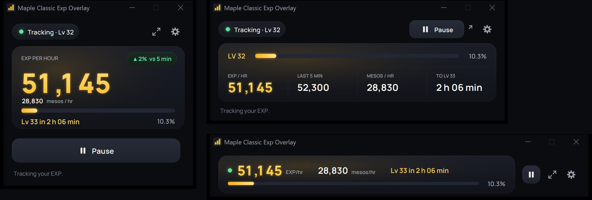
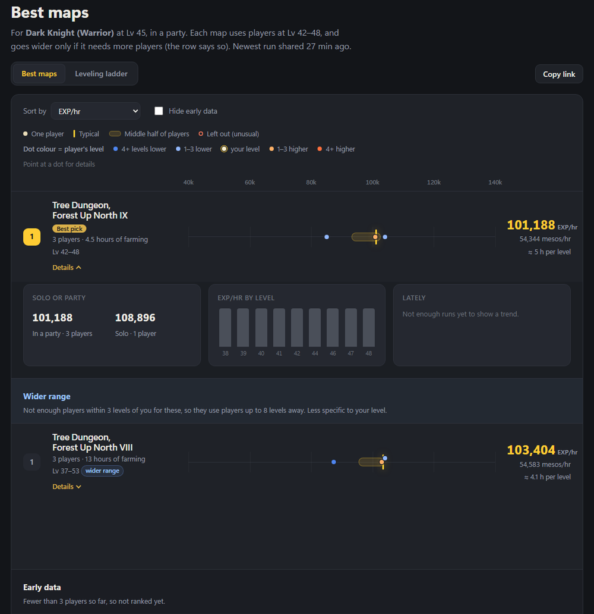
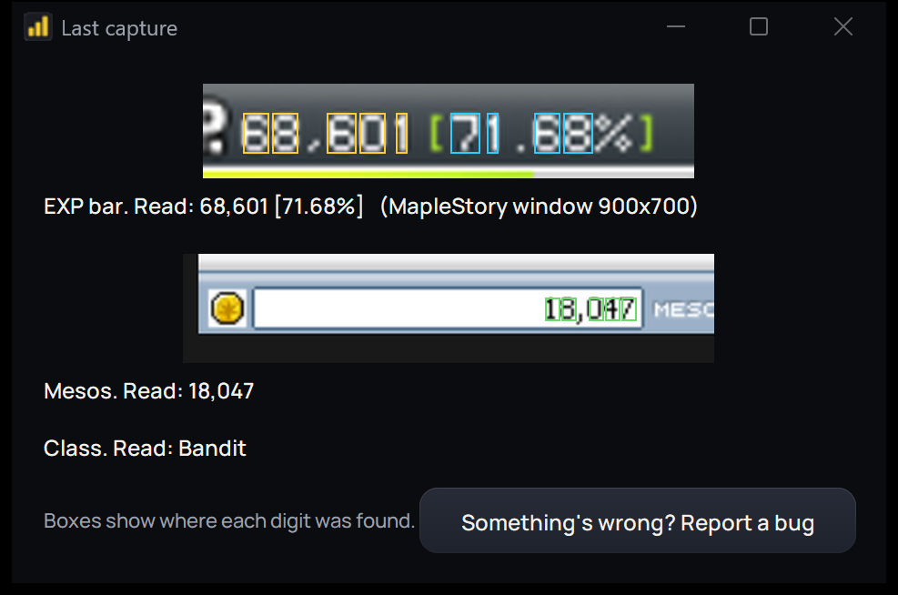

# Maple Classic Exp Overlay（枫之谷经典版经验悬浮窗）：完整指南

简要说明见 [README](../README.md)，其余内容都在这一页。

[如何使用](#如何使用) · [精简模式形状](#精简模式形状) · [快捷键](#快捷键) · [日志](#日志) · [设置](#设置) · [净金币与药水](#净金币与药水) · [你职业的最佳地图](#你职业的最佳地图) · [准确度如何？](#准确度如何) · [出问题了怎么办？](#出问题了怎么办) · [更新](#更新)

## 如何使用

1. **启动 MapleStory。** 窗口化、无边框或全屏都可以，任何大小均可。
2. **打开 Maple Classic Exp Overlay。** 它会自己找到游戏窗口。
3. **移动悬浮窗，别让它遮住游戏里的这些部分：**
   - 小地图（左上角）
   - 经验条（底部）
   - 背包底部的金币
   - 队伍列表

   悬浮窗是从你的屏幕上读取这些内容的，所以它无法透过自己看东西。如果它挡住了，会在窗口底部提示你。它会记住你放的位置。
4. **点击开始**，然后正常游玩。只需要点一次：
   - 如果 15 秒内没有获得经验，或者你离开了地图，它会**自动暂停**，并在你下次获得经验时继续。暂停的时间不计入，所以经验/小时只反映你真正刷怪的时间。
   - 换到另一张地图时，该地图的数字会从零开始（除非开启了**不重置**，见下表）。
5. **想统计金币？** 开始时打开一次背包（任意标签页），之后游玩时偶尔再打开。它不需要一直开着。如果悬浮窗提示你打开背包，请照做。你在商店、仓库或交易中花费或转移的金币不会计入，只有你拾取的金币才算。
6. **想看净金币？** 请把你使用的药水放在快捷栏上。见[净金币与药水](#净金币与药水)。

几秒钟内它就会显示你的等级和当前经验。每小时的数字要等你获得一点经验之后才会出现。

| 控件 | 作用 |
|---|---|
| **状态胶囊**（左上角） | 显示它正在做什么：追踪中、已暂停，或哪里出了问题（例如找不到经验条） |
| **开始 / 暂停 / 继续** | 开始追踪。**暂停**会停下，直到你点击**继续**。 |
| **重置**（圆形箭头） | 从零开始新的一轮，并重新寻找小地图、背包和队伍列表（移动过它们之后很有用） |
| **记录本次**（开关） | 关闭后，当前这一轮不会写入日志，例如你在测试地图或等队友时。屏幕上仍会显示所有数字。离开地图或停止获得经验后它会自动重新打开，所以下一轮照常记录。 |
| **不重置**（开关） | 适用于在多个地图间切换的刷怪：换地图不再暂停，也不会重新开始计数（没有经验的间断仍会暂停）。它会一直保持开启，直到你关掉。开启时产生的记录只保存在本机：绝不会分享到最佳地图网站。 |
| **详情** | 显示或隐藏额外的数字（已获得、当前、金币、已用时间） |
| **…**（更多） | 如果它找不到经验数字，可用**选择区域**拖出一个框来框住经验数字（之后它会变成**跟随游戏**，点击可恢复自动寻找）。**查看截取**会准确显示它从屏幕上读到了什么。 |
| **最佳地图** | 打开[最佳地图网站](#你职业的最佳地图)，并已按你的等级、队伍人数和职业筛选好 |
| **日志图标** | 打开或关闭日志 |
| **精简图标** | 切换到小得多的窗口，只显示主要数字和开始/暂停，形状为你选择的[精简形状](#精简模式形状)。再点一次可还原。按 Shift+4 或双击大数字效果相同。 |
| **齿轮图标** | 设置 |

## 精简模式形状

精简模式有三种形状。首次启动时会询问你想要哪一种，之后可随时在设置的**精简模式形状**中更改。完整视图和日志的外观始终不变。

- **方形：** 窄卡片，包含大号的经验/小时数字、金币/小时、等级条和开始/暂停。
- **宽屏：** 横向加长，等级条在上方，四个数字排成一行：经验/小时、近 5 分钟、金币/小时，以及距下一级的时间。
- **长条：** 一条细长条，显示经验/小时、金币/小时、距下一级的时间和一条纤细的等级条。只有在需要你注意时才会显示状态行。

## 快捷键

当 MapleStory（或悬浮窗）是最前面的窗口时它们才有效，所以不用切出游戏：

| 按键 | 作用 |
|---|---|
| **Shift+1** | 开始 / 暂停 |
| **Shift+2** | 重置 |
| **Shift+3** | 开启 / 关闭「记录本次」 |
| **Shift+4** | 精简 / 完整 |
| （默认无） | 开启 / 关闭「不重置」：可在 ⚙ 中为它设置按键 |

状态行会说明发生了什么，例如“Shift+1：已暂停”。快捷键开启时，这些按键只会发给悬浮窗，所以按 Shift+1 不会在游戏聊天里输入 **!**。如果这妨碍了你，可以在 ⚙ 中更改（或关闭）：点击一项，然后按下想要的按键（再次点击或按 Esc 可取消）。按退格键可关闭某一项。

## 日志

点击**日志图标**（左上角，状态胶囊旁边）打开日志。它就是[特写截图](screenshot-main.png)里右侧的那张表。

- **不间断刷怪 5 分钟后**，会为该地图、你的等级和队伍人数添加一行。
- **之后每过 5 分钟**会更新这一行，所以刷得越久，数字越准确。
- **时间**显示这一行基于多长的数据，每次更新增加 5 分钟。
- **职业**从状态栏读取（绝不是你的角色名）。不同职业会分成不同的行。
- **15 分钟记录：** 日志下方还会统计在同一张地图、同样队伍人数下不间断刷怪满 15 分钟的进度（“15 分钟记录：已进行 7 / 15 分钟”）。升级不会打断它；中断、换地图或更换队伍人数则会让它重新开始。完成的记录会单独保存，并且（如果你同意）会分享给[最佳地图网站](#你职业的最佳地图)（只有干净的记录，详见该节）。
- **灰色的行**是在悬浮窗之外被修改过的。悬浮窗写入的每一行都有签章，所以手工编辑或添加的行很容易被识别，并且不会计入最佳地图网站。删除一行，或在悬浮窗中重命名地图，则没有问题。
- **休息会重置 5 分钟计时。** 休息指 15 秒没有经验（可在 ⚙ 中更改）。更换地图或队伍人数也会重置计时。开启**不重置**后，换地图不会重置：这一行会写出它涵盖的所有地图（“地图A/地图B”）。
- **不想记录某一轮？** 关闭**记录本次**。该轮结束后它会自动重新打开。
- **单人**表示只有你一个人。**4人**表示 4 人队伍。
- 金币/小时下方的 **?** 表示没有查看过你的背包。
- **净值/小时**是金币/小时减去药水花费（在统计药水的情况下）。
- **右键点击一行**可以：
  - **复制此行**，以便粘贴到 Discord 或任何地方
  - **重命名地图**，如果它把名字读错了（它会记住这次修正，下次沿用）
  - **删除记录**
- **组队游玩？** 某张地图当天的各个队伍人数会合并成一行（例如 **4–5人 ▸**），数字是这段时间的总和。点击它可以查看每个队伍人数各自的一行。
- **备注：** 点击一行，在日志下方的输入框里写下关于它的任何内容：队友、药水、掉落、为什么离开。带有备注的行会在**备注**列显示 ✎。备注会随着输入自动保存，**并且只会保存在你的电脑上**（在你的日志文件中）：绝不会分享给最佳地图网站（只有完成的 15 分钟记录会被分享，而它们不含备注）。重命名地图、更新悬浮窗或继续在该行刷怪，都会保留它的备注。删除一行时会同时删除它的备注，并且会先询问你。
- **看不全某一列？** 拖动列标题之间的分隔线可以调窄或调宽列。日志打开时，你也可以拖动窗口边缘把窗口放大。两者都会被记住。

## 设置

- **无经验后自动暂停：** 多久没有经验就自动暂停。这也会重置日志的 5 分钟计时。默认 15 秒。
- **透明度。** 让悬浮窗变得半透明，最高 40%。（再高的话它可能淡出到看不见，连设置也一起看不见了。）
- **大小。** 让文字和整个窗口变小或变大，范围 60% 到 200%。最小的文字会停在可读的大小，所以不会小到看不清。大小是针对每块屏幕分别计算的，因此把窗口移到 Windows 缩放比例不同的屏幕（例如 5K 和 1440p 屏幕）上，两边看起来大小一致。如果某个大小会使窗口超出屏幕，则使用能放下的最大尺寸，设置里也会说明。
- **精简模式形状。** 方形、宽屏或长条：精简模式的外观。见[精简模式形状](#精简模式形状)。
- **药水。** 开启或关闭净金币与药水统计，并可在**价格**中输入你自己的价格。见[净金币与药水](#净金币与药水)。
- **不重置：跨地图保留计数。** 与主窗口上的开关相同。见[如何使用](#如何使用)。
- **等级备用值。** 仅用于只显示百分比的经验条，且无法从徽章读取等级时：在这里输入你的等级。见[准确度如何？](#准确度如何)。
- **快捷键。** 开启或关闭它们，并可更改。见[快捷键](#快捷键)。
- **始终置于其他窗口之上。** 让悬浮窗保持在游戏上方。默认开启。
- **启动时检查更新。** 默认开启。见[更新](#更新)。
- **匿名分享我的 15 分钟记录。** 见[你职业的最佳地图](#你职业的最佳地图)。
- **每日发送运行状况报告。** 每天一次，发送一份简短的匿名摘要，说明悬浮窗读取你游戏的效果。见[隐私](privacy.md)。
- **数据文件夹。** 打开保存你的日志和设置的文件夹。
- **检查更新。** 立即检查。
- **报告错误。** 见下文。

## 净金币与药水

金币/小时是你拾取的金币。**净金币/小时**会扣除你喝掉的药水花费，这样你就能看出哪张地图真正赚钱。例如：每小时 300,000 金币，减去 16,600 的药水花费（200 个红药水 × 50 + 30 个蓝药水 × 220），得到**每小时净 283,400 金币**。

- **请把你使用的药水放在快捷栏上**（游戏右下角的快捷键栏），这样悬浮窗才能看到它们的数量。数量减少一个，就算使用一个。只放在背包窗口里的药水是看不到的。
- **两种栏样式都支持：** 键盘栏和手柄栏（标准或十字风格），游戏 UI 大小为“默认”或“理想”。悬浮窗会自动识别你用的是哪一种，运行中也可以在它们之间切换。
- **如果没有显示花费，** 悬浮窗会说明原因，而不是显示 0：“未看到药水栏”（一分钟内没看到这个栏，例如被什么东西遮住了），或“没有价格：……”（它统计到的某种药水还没有价格；请在**价格**中输入）。
- **只在追踪时统计。** 暂停或在城镇时不统计。拾取或购买更多药水绝不会被算作使用。
- **价格采用 NPC 商店价格。** 没有 NPC 出售的药水在你填写实际购买价之前按免费计算，在 ⚙ 的**设置 > 药水 > 价格**中设置。商店价格也可以在那里修改。
- **不想要？** 在**设置 > 药水**中关闭。关闭后不统计，也不显示净值。
- **你的药水数据绝不会离开你的电脑。** 它不会发送到最佳地图网站。
- **金币/小时不包含商店、仓库和交易造成的变化，** 而且背包不需要一直打开：开始时打开一次，之后偶尔打开，以及在悬浮窗提示时打开（例如回城之后）。

## 你职业的最佳地图

**[mcwo.app](https://mcwo.app)** 根据玩家真实的刷怪数据，展示在哪些地图上你的职业和等级（单人或组队）能获得最高的经验/小时和金币/小时。点击悬浮窗顶部的**最佳地图**即可打开，并已为你填好筛选条件。

- **输入你的等级以及你是单人还是组队，然后选择职业和转职路线。** 路线以四转职业命名，如夜行者或主教，并包含此前的职业（暗影双刀包括盗贼、侠盗和暗影双刀）。30 级以下你还是一转，所以路线是灰色的，显示的是你职业所有玩家的数据。
- **你的等级附近**默认为上下各 3 级。如果某张地图没有足够多的玩家在这个范围内，就会放宽到 5 级，并在该行标明（“范围更宽”）。任何人数的队伍会合并统计。
- **默认先显示前 5 张地图。** 点击下方的**显示更多地图**可查看其余的。
- **每张地图会显示**它的经验/小时和金币/小时，以及它基于多少玩家和多少小时的刷怪数据。每一行上的圆点是玩家的典型记录，颜色表示他们的等级与你的差距。
- **包含新玩家：** 新玩家的记录要在 24 小时且 4 次记录后才会计入，所以网站一开始比较严格。勾选**包含新玩家**可以把他们也显示出来。这些地图会有标注，新玩家的圆点会变淡，且名称不在游戏列表中的地图绝不会从新玩家的数据里显示出来。
- **排序和筛选**列表，打开某张地图的**详情**（按队伍人数和按等级的经验/小时），或切换到**升级阶梯**查看升级过程中该用哪些地图。**复制链接**可以分享你当前看到的内容。

- **数据来自干净的 15 分钟记录：** 在同一张地图、同样队伍人数下不间断刷怪 15 分钟。日志会显示你的进度（“15 分钟记录：已进行 7 / 15 分钟”）。对网站来说，15 秒没有经验就会结束一次记录（无论你的日志如何设置）；期间打开过商店、仓库或交易窗口的记录绝不会被分享；并且只有在悬浮窗读到了你的队伍人数后，记录才会被分享。
- **只在金币可信时才带金币：** 只有当你在开始时以及结束后 30 秒内查看过背包，记录才会连同金币一起发送，否则只发送经验。如果你在一轮刚结束后暂停，悬浮窗可能会提示你打开背包。
- **是否分享由你决定。** 第一次启动悬浮窗时，它会询问是否分享你的记录。你可以随时在 ⚙ 中更改。
- **分享的内容：** 地图、你的等级、职业和队伍人数，你获得的经验和金币（金币不可信时只含经验），以及一个代表你这份悬浮窗的随机 ID。绝不包含你的角色名，也绝不包含任何与药水有关的内容。
- **保持诚实：** 网站使用典型（中位数）记录，每位玩家只计一次，排除与该地图其他玩家差距过大的记录，新玩家的记录要在 24 小时且 4 次记录后才计入，并且一张地图要有 3 位不同的玩家刷过才会参与排名（在此之前属于早期数据：除非取消勾选**隐藏早期数据**否则不显示，且显示为灰色）。每位玩家的典型记录都是图表上的一个圆点，所以任何异常都很容易发现。

## 准确度如何？

它在计数之前，会对读到的一切进行二次核对：

- **经验：** 数字和百分比必须彼此吻合，并且与你的等级所需经验吻合。
- **金币：** 一个新的数额必须连续出现在好几次读取中。
- **突然的跳变：** 经验的跳变或升级必须经过确认才会计入。看起来多了或少了一位数字的金币数额会被忽略。
- **死亡：** 你损失的经验不会从经验/小时中扣除。它会告诉你损失了多少，然后从那里继续。
- **游戏的“默认比例（已应用过滤器）”：** 悬浮窗会自动发现这个设置已开启（几秒后），并按游戏在该设置下的绘制方式来读取经验数字、队伍人数、地图名、金币和药水数量。
- **不确定时，它会等待。** 如果读不清楚，就会跳过，而不是乱猜。
- **只有百分比的经验条：** 约 Lv 57 之后，游戏不再显示经验数字。此时悬浮窗会从橙色的 **LV** 徽章读取你的等级并据此推算经验，所以这些数字是估算值，并显示 ≈。如果读不出徽章，它会使用你之前的等级（仅限同一角色），你也可以在设置中手动输入。这些估算值绝不会分享给最佳地图网站。

每个版本都用成千上万个读错的数字做过测试，也用真实游戏截图贴到许多不同背景、不同窗口大小上做过测试。

## 出问题了怎么办？

**请先点击查看截取。** 它会准确显示悬浮窗读到了什么，并在每个数字周围画上方框：

| 问题 | 解决办法 |
|---|---|
| 打开 Maple Classic Exp Overlay.exe 时弹出错误 | 请先解压压缩包（见 [如何安装](../README.md#如何安装)）。它不能在压缩包内部运行，也不能离开它所在的文件夹运行。 |
| “未找到 MapleStory 窗口” | 请先启动游戏。如果已最小化，请将其还原。 |
| “找不到经验条” | 确保没有任何东西遮住游戏底部的经验条，包括悬浮窗。如果游戏窗口非常小，请把它调大。 |
| 查看截取显示的是屏幕上错误的部分 | 如果按钮显示的是**跟随游戏**，请点击它。 |
| 金币显示“请打开背包” | 打开背包，并确保底部的金币没有被遮住。在较小的游戏窗口中，聊天栏可能会遮住它，所以请把背包往上拖一点。如果仍然不显示，请站着不动一会儿，等背包不再半透明。 |
| 日志显示“尚未读取到地图” | 确保小地图在游戏左上角已打开，并且悬浮窗没有遮住它。 |
| “……悬浮窗文件夹中缺少文件 (tessdata\eng.traineddata)” | 重新下载压缩包并完整解压。如果文件仍然缺失，可能是杀毒软件删除了它：请放行悬浮窗文件夹后重新解压。没有它，经验和金币仍可正常使用。 |
| “……此文件夹的名字含有特殊字符” | 把悬浮窗文件夹移到简单的位置，例如 C:\Games\（路径中不要有带重音符号或非英文字母的字符，建议也避免中文路径）。没有它，经验和金币仍可正常使用。 |
| 地图名不对 | 右键点击该日志行，选择**重命名地图**。 |
| “本窗口遮住了……” | 把悬浮窗拖到别的位置。 |
| 数字不再更新，或其他任何问题 | 请报告（见下文）。 |

**要报告错误，** 请点击 ⚙ 中的**报告错误**（或查看截取中的**出问题了？报告错误**），然后选择一种方式：
- **发送给开发者**（无需账号）：写下出了什么问题，展开*将发送的内容*查看将要发送的全部内容（仅文字，不含图片），然后点击**发送**。每天最多发送 3 份。
- **在 GitHub 上报告**（需要免费的 GitHub 账号，并且可以附上图片）：
1. 浏览器会打开 GitHub 上的错误报告页面，已填好你的版本和悬浮窗读到的内容。不包含任何个人信息，在你点击 Submit 之前也不会发送任何东西。
2. 会打开一个文件夹，里面有 **bug-report.png**（悬浮窗读到的内容：经验条、金币、职业和地图名）和 **bug-report.txt**（运行情况：你的屏幕和游戏窗口大小、它找到了什么、它最后说了什么，以及任何错误）。把两个文件都拖进报告里。它们都不含你的角色名或 Windows 用户名。程序还会询问是否保存一张游戏整个窗口的小图：那张图可能显示聊天和名字，所以只有你选择“是”才会保存，是否附上也由你决定。
3. 用一句话写下出了什么问题，然后点击 **Submit**。（你需要一个免费的 GitHub 账号。）

## 更新

这是测试版，我仍在不断添加功能和修复问题。

**新名称：** 自 v0.9.3 起，它改名为 Maple Classic Exp Overlay，此前叫 Maple EXP/hr。你的日志和设置会沿用。

**有新版本时，** 悬浮窗会在你启动时告诉你，并显示新增内容。点击**获取更新**打开下载页面，或者点击**以后再说** / **跳过此版本**暂时不更新。

**更新方法：** 从[下载页面](https://github.com/mozziexwz/mapleEXP/releases/latest)下载最新的压缩包（Mac 上是 .dmg），用它替换旧文件夹。你的日志、备注和设置会保留，因为它们是单独保存的（⚙ → **数据文件夹**会显示位置）。

**卸载方法：** 删除它的文件夹。如果还想删除你的日志和设置，请删除**数据文件夹**所打开的那个文件夹。

每个版本的变更见 [CHANGELOG.md](../CHANGELOG.md)。
